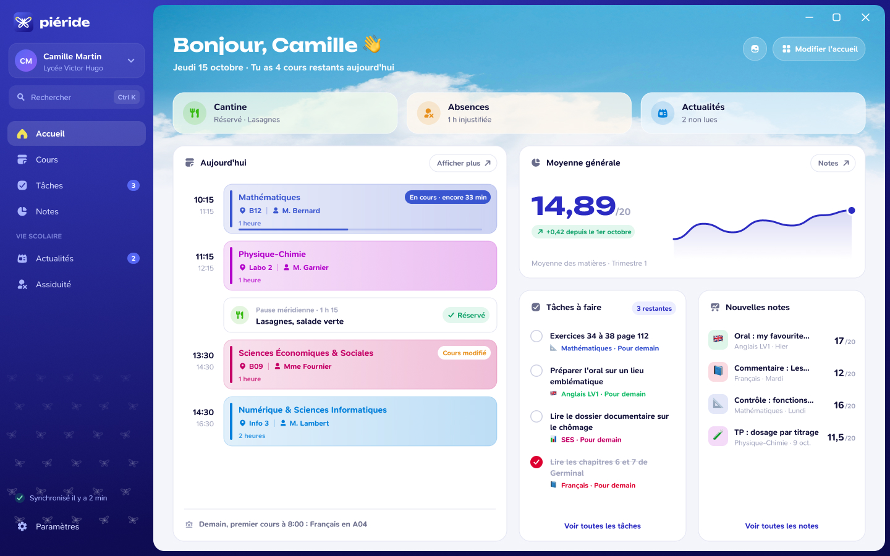

# Le tableau de bord

L'accueil est le point de départ de Piéride. La maquette ci-dessous rassemble une vue de la journée, des informations scolaires et des raccourcis vers les autres modules.

*Maquette de présentation : les notes, devoirs, actualités et éléments de cantine qui apparaissent sont des exemples. Cette image ne décrit pas exactement une version livrée.*

## Lire l'écran

La maquette met en avant :

- les prochains cours et leurs horaires ;
- les tâches à terminer et les notes récentes ;
- des informations utiles qui conduisent vers les modules concernés ;
- un bandeau d'accueil personnalisable.

Les données réellement visibles dépendent du compte et des capacités de son service scolaire. Le tableau de bord évolue encore ; consulte la page [Modules](/welcome/modules) pour connaître les écrans actuellement intégrés.
