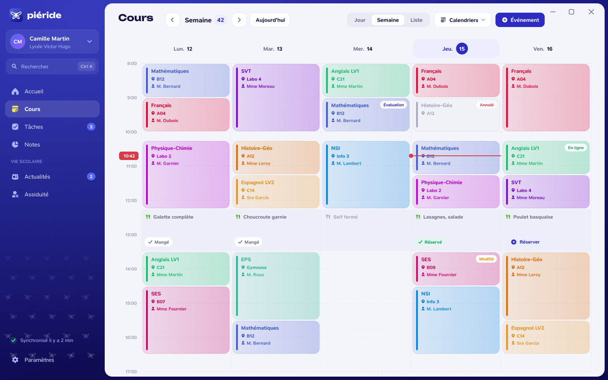

# L'emploi du temps

La maquette présente une semaine de cours, les changements d'horaire et un panneau de détail. L'application propose aussi plusieurs façons de consulter le calendrier selon les vues intégrées au build utilisé.

*Maquette de présentation. Les horaires, noms et salles sont fictifs. Les repas et réservations visibles dans l'image illustrent une piste de conception : les services de cantine ne sont pas disponibles dans la version de développement actuelle.*

## Dans un cours

Un cours peut regrouper son horaire, sa matière, sa salle, son enseignant et les informations que le service scolaire transmet. Certains établissements ne renseignent pas tous ces champs.

Les événements ajoutés à un calendrier local peuvent aussi apparaître dans l'emploi du temps. La disponibilité et les détails importés dépendent du service associé au compte. Consulte [Services scolaires](/welcome/services).
