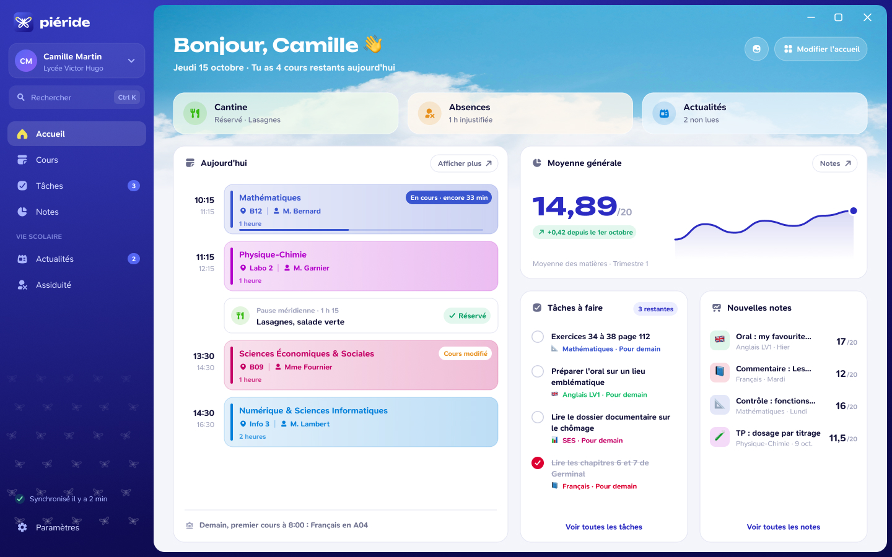

# L'interface Piéride

Cette rubrique présente les écrans de Piéride et les choix de conception qui les accompagnent. Les visuels sont des **maquettes de présentation** : ils illustrent une direction et des idées d'interface, pas une version téléchargeable ni une capture garantie de l'application actuelle.

*Maquette de présentation de l'accueil. Les données et certains modules affichés sont fictifs ou en préparation.*

## Explorer les écrans

- [L'accueil](/designer/accueil) : le tableau de bord et ses informations principales
- [Les cours](/designer/cours) : l'emploi du temps et le détail d'un cours
- [Notes et tâches](/designer/notes-et-devoirs) : notes, devoirs et suivi du travail
- [Personnaliser l'application](/designer/personnaliser) : thème, couleurs et matières

La documentation décrit l'état du produit séparément de ses maquettes. Consulte [Les modules](/welcome/modules) et [Les services scolaires](/welcome/services) pour savoir ce qui existe dans le code de développement actuel.
