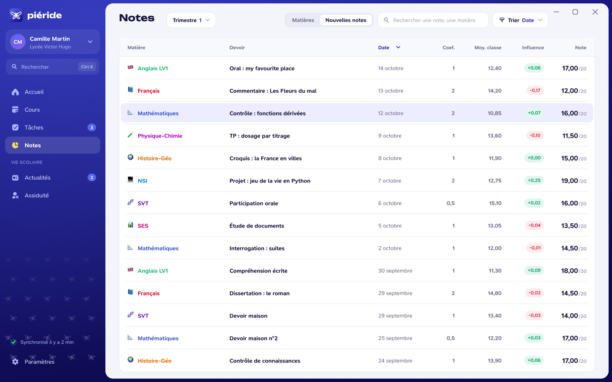
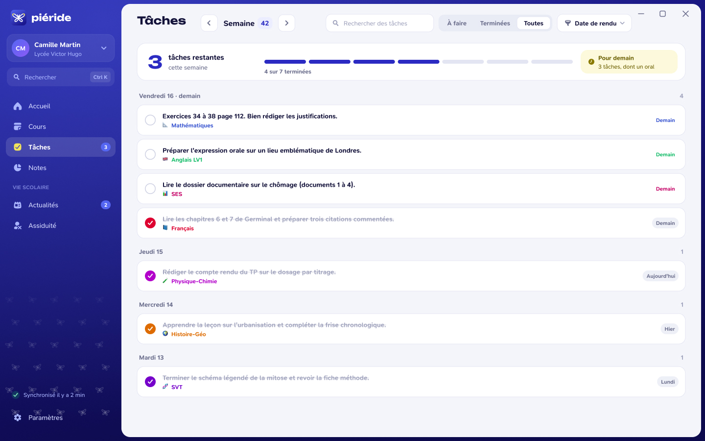

# Notes et tâches

Ces visuels présentent deux modules distincts : les **Notes**, pour consulter les évaluations, et les **Tâches**, pour suivre les devoirs à faire.

*Maquette de présentation : les notes et les moyennes sont fictives, et l'organisation visuelle peut évoluer.*

*Maquette de présentation : le suivi et les exemples de devoirs illustrent le module, pas une capture d'un compte réel.*

Les données de Notes et de Tâches viennent du service scolaire lié au compte. Leur affichage dépend des informations qu'il transmet. Le module Tâches permet également de suivre l'état d'un devoir dans Piéride. Les capacités disponibles sont détaillées dans [Services scolaires](/welcome/services).
