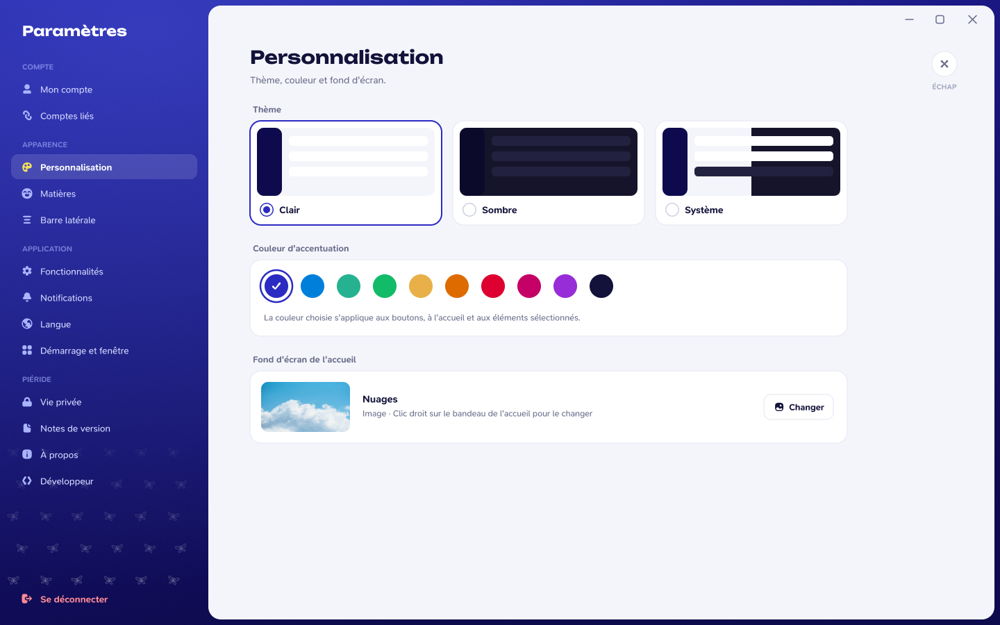

# Personnaliser l'apparence

La maquette ci-dessous montre les réglages d'apparence : thème clair, thème sombre ou suivant le système, couleur d'accent, matières et fond de l'accueil.

*Maquette de présentation. Les options et leur emplacement peuvent changer selon la version de développement.*

## Thème et couleur

Piéride est conçu pour rester lisible dans les thèmes clair et sombre. La barre latérale conserve la marque indigo ; le thème s'applique à la zone de travail. La couleur d'accent sert à mettre en évidence les actions et les sélections.

## Matières et accueil

Quand les réglages correspondants sont présents dans ton build, tu peux personnaliser les couleurs ou les symboles des matières et choisir un fond pour l'accueil. Ces préférences restent propres à ton installation.

Pour connaître les commandes réellement disponibles, ouvre les Paramètres de ton application et consulte [Paramètres](/welcome/parametres).
