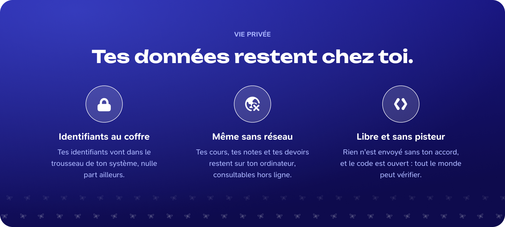

Piéride manipule des identifiants et des données d'élèves, souvent mineurs. Cette page dit exactement où vont tes données.

*Cette illustration est une maquette de présentation et résume les principes de stockage local. Lors d'une synchronisation, les données nécessaires sont échangées avec le service scolaire connecté.*

## Où sont tes données

| Donnée                                                          | Où elle est                                                                                                  | Remarque                                                                                                                          |
| --------------------------------------------------------------- | ------------------------------------------------------------------------------------------------------------ | --------------------------------------------------------------------------------------------------------------------------------- |
| Identifiants et jetons de session                               | **Trousseau du système** : Trousseau macOS, Gestionnaire d'identification Windows, Secret Service sous Linux | Jamais dans la base, les réglages ou le journal. Effacés avec le compte.                                                          |
| Données scolaires (cours, devoirs, notes, actualités, absences) | Base SQLite `pieride.db`, dans le dossier de configuration de l'app                                          | Par exemple `~/.config/Pieride` sous Linux, `%APPDATA%\Pieride` sous Windows, `~/Library/Application Support/Pieride` sous macOS. |
| Réglages (thème, langue, modules, ordre des modules)            | Stockage local de l'interface                                                                                | Aucun secret.                                                                                                                     |
| Photo de profil et fond d'écran                                 | Dans les réglages, en image redimensionnée                                                                   | Choisis par toi.                                                                                                                  |
| Journal                                                         | En mémoire seulement                                                                                         | Disparaît à la fermeture de l'app. Jamais écrit sur le disque.                                                                    |

## La base n'est pas chiffrée

Dans la première version, la base SQLite est **en clair**. Un accès à ton compte utilisateur donne accès à ces données. Protège ta session, et efface les données en retirant le compte (voir [Comptes et services](/welcome/comptes-et-services)).

## Ce que Piéride envoie, et à qui

Piéride n'envoie **aucune donnée d'usage** : il n'intègre à ce jour aucun outil de mesure ni de télémétrie.

Il ne se connecte qu'à :

- les **serveurs de ton établissement** (PRONOTE, et plus tard les autres services), à l'adresse qu'il a donnée ;
- les **services de recherche d'établissement** utilisés à la connexion (géolocalisation des établissements PRONOTE, recherche de la ville) ;
- les **liens** que tu ouvres, dans ton navigateur (le dépôt GitHub de Piéride, par exemple).

Toutes les connexions se font en **HTTPS**. Le réseau est filtré par une liste de domaines autorisés : Piéride ne peut joindre que ceux-là, plus l'adresse de ton établissement, ajoutée à la connexion.

## La connexion ENT

Pour un espace numérique (ENT), la connexion se fait dans une **fenêtre séparée** :

- elle n'a accès à aucune commande de Piéride ;
- elle est en navigation privée : rien de l'ENT ne reste sur le disque ;
- ton mot de passe reste sur la page de l'ENT ;
- Piéride ne récupère que l'identifiant PRONOTE et le jeton de session.

## Pour retirer tes données

- **Retirer un compte** : supprime toutes ses données dans l'app et ses identifiants dans le trousseau.
- **Désinstaller l'app** ne suffit pas : le dossier de configuration (voir le tableau plus haut) et les entrées du trousseau restent. Retire d'abord les comptes dans l'app, puis supprime le dossier si tu veux tout effacer.

## Signaler une faille

N'ouvre pas une issue publique. Signale-la en privé depuis l'onglet **Security** du dépôt : [Signaler une faille](https://github.com/PierideApp/Pieride/security/advisories/new).

